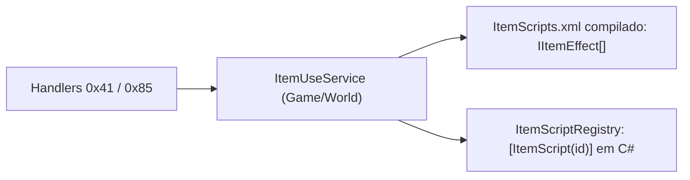

# Plano — Efeitos de itens via mini-linguagem de script

> Especificação para revisão antes da implementação. Fonte: `table\item_info_us.dat` v322 (extraído com
> `tools/drpg_pack.py`), `captures.db` (C2S `0x41` / `0x85`) e o código atual (`ItemUseHandler`, `ItemTeleportHandler`, `Taming`).

## 1. Diagnóstico

- ✅ **O cliente não guarda o efeito do item.** `item_info_us` tem tipo (col. 2), subtipo (3), preço, pilha/duração (26),
  descrição em linhas (4–12) e um resumo em texto livre (28: `"Recover 100 HP"`, `"Move to Theme Park."`, `"ATK+5% (10min)"`).
  Não existe coluna de "id de efeito": a lógica ficava no servidor oficial e precisa ser recriada aqui.
- ✅ **O tipo não determina o comportamento.** O tipo 7 (885 itens) mistura poções, caixas, scrolls de EXP e buffs.
  O tipo serve para *gating* (validação), não para despacho.
- ✅ **Volume grande, poucos comportamentos.** ~2.700 itens em tipos usáveis (3, 4, 7, 11, 12, 29, 30, 47), mas agrupados em famílias:

| Família | ~Itens | Efeito |
|---|---:|---|
| `Packaged …` (tipo 12/sub 3) | 762 | entrega a peça de roupa ❓ (id parece codificar a peça) |
| `[Tamer Title]` (29) + títulos de evento (30) | ~600 | concede título |
| Teleportes (3) | ~65 | muda mapa/posição (col. 28 traz o destino por nome) |
| Comidas/vitaminas (4) | ~40 | recupera HP/VP/EVP |
| Caixas, tickets, cupons de bits | centenas | entrega itens/bits (fixo ou aleatório) |
| Poções e scrolls temporários (7) | dezenas | buff com duração |
| Digitamas, `Replacement Item` | dezenas | entrega Digimon |
| Únicos (renomear, resetar recorde, Warp Device) | poucos | lógica própria |

- ✅ A col. 28 dos usáveis tem só **86 cláusulas distintas** (normalizando números): `Move to <mapa>` (65), `HP +#`, `VP +#`,
  `Recover # HP/VP/EVP`, `Recover HP by #%`, `Digimon EXP + #%(#min)`…
- ❓ **Pouca evidência de resposta.** `captures.db` tem 14 usos de `0x41`. Ex.: `VIP Daily Potion (EXP)` → `0xB4`×N + `0x73`;
  Digital Administration Bureau (id 20) → `0x11`… `0x41` → `0xB0` → `0xFC`. Cada efeito novo precisa de captura própria.

## 2. Decisão: catálogo de efeitos + mini-linguagem no XML

Implementar **efeitos** (≈15–20), não itens. Cada item declara, em `Resources/Item/ItemScripts.xml`, uma lista de chamadas:

```xml
<Item ID="411"   Name="Apple"                   OnUse="HealHP(100)" />
<Item ID="30"    Name="Chicken Combo"           OnUse="HealHP(150); HealVP(50)" />
<Item ID="23146" Name="100 Million Bits Coupon" OnUse="AddBits(100000000)" />
<Item ID="25180" Name="Duft Chocolate (Kadaif)" OnUse="AddBuff(AtkRate, 5, 600)" />
<Item ID="21"    Name="Theme Park"              OnUse="Teleport(map=ThemePark, x=10, y=10)" />
<Item ID="4"     Name="Crest of Knowledge +1"   OnEquipped="AddMaxVP(50); AddAtk(15); AddBr(70)" />
```

O texto é **compilado na carga** em objetos tipados; em runtime não há parse nem interpretação de texto.

### 2.1 Gramática (fechada)

```
script := call (';' call)* [';']
call   := Ident '(' [arg (',' arg)*] ')'
arg    := [Ident '='] value
value  := número inteiro | Ident (enum/constante) | "string"
```

Regras fixas — **não** evoluir a linguagem além disto:
- **Sem** variáveis, `if`, expressões aritméticas ou laços. Item que precisa de lógica condicional vira script C# (§2.4).
- Argumentos posicionais seguem a ordem declarada da função; nomeados (`map=1`) são opcionais e recomendados quando há ambiguidade.
- Constantes simbólicas resolvidas na carga: enums de stat (`AtkRate`, `MaxHpRate`…), nomes de mapa do `map_us`.
- Dados volumosos ficam **fora** do script: `OpenBox(TreeBoxLow)` referencia uma tabela de conteúdo, não lista pesos inline.

### 2.2 Ganchos e catálogos separados

| Gancho | Natureza | Exemplos | Regras |
|---|---|---|---|
| `OnEquipped` | modificador passivo | `AddAtk`, `AddMaxHPRate`, `AddCardSlash` | soma em `EquipmentBonus`, reversível, sem pacotes |
| `OnUse` | ação | `HealHP`, `HealHPRate`, `Teleport`, `AddBits`, `AddBuff`, `GrantItem`, `OpenBox`, `GrantTitle`, `GrantDigimon`, `TameWild` | muda estado, consome o item, responde ao cliente |

Cada gancho tem **seu próprio registro de funções**: `Teleport` em `OnEquipped` é erro de carga.

### 2.3 Validação na carga (fail-fast)

`GameDataLoader` falha o boot (`GameDataException`) com item, atributo e coluna do erro para: função desconhecida no gancho,
aridade/tipo de argumento errados, argumento nomeado inexistente, constante não resolvida, `ItemID` duplicado ou ausente do
`item_info_us`. Um teste carrega o XML real e garante que tudo compila.

### 2.4 Execução (`OnUse`)



- `IItemEffect { Validate(ctx) ; Apply(ctx) }`; `ItemUseContext` carrega jogador, item, alvo (Digimon do time / selvagem / coordenada), `GameWorld`, `Random`.
- `ItemUseService.Use(...)`:
  1. **Guards de servidor** (AGENTS.md §4): `Uid` + `ItemId` pertencem ao jogador e à bolsa esperada, `Amount > 0`,
     estado compatível (batalha, mapa), alvo válido, nível/`Flag` do item, cooldown.
  2. `Validate` de **todos** os efeitos antes de qualquer mutação (espaço na bolsa, vaga de Digimon, mapa andável…).
  3. `Apply` em sequência → `Consume(item, 1)` → `RequestImmediateSave()` → pacotes.
  4. Sem script: mantém o comportamento atual (`0xC3` + `SendDebug`).
- Handlers ficam finos: `ItemUseHandler` (0x41) e `ItemTeleportHandler` (0x85) apenas leem o pacote e delegam.
- Casos únicos: classes `[ItemScript(id)]`, no mesmo padrão do `NpcScriptRegistry`. Prioridade: script C# > XML.

## 3. Bootstrap offline

`tools/extract_item_scripts.py` (irmão do `extract_equipment_effects.py`) gera o XML inicial a partir da col. 28 e da descrição,
para as cláusulas inequívocas (`HP +#` → `HealHP(#)`, `Recover HP by #%` → `HealHPRate(#)`, `Move to <mapa>` → `Teleport(map=…)`
cruzando com `map_us`). Saída marcada com comentário `✅`/`❓`; coordenadas de chegada e conteúdo de caixas vêm de captura.
O XML gerado é revisado e commitado; o servidor carrega só o XML.

## 4. Etapas (um PR cada)

1. **Base** — parser + compilador + registros por gancho + `ItemUseService`; migrar Taming Net (`TamingNets.xml` continua sendo a
   tabela de chance) e Teleport 900/907 para efeitos (`TameWild`, `TeleportToCoordinate`) **sem mudar comportamento**.
2. **Recuperação e bits** — `HealHP/VP/EVP`, `HealHPRate…`, `Revive`, `AddBits`. Itens do tipo 4 e cupons.
3. **Teleporte para mapa** — `Teleport(map, x, y)` para os ~65 tickets; chegada por captura (❓).
4. **Entrega** — `GrantItem`, `OpenBox(tabela)`, `GrantTitle`, `Unpack` (Packaged), `GrantDigimon`.
5. **Buffs temporários** — infraestrutura de efeitos ativos (expiração, persistência, tick no mundo, `StatFormulas`, pacote S2C ❓ `0xB4`/`0x73`).
6. **Migração opcional** — `EquipmentEffects.xml` → `OnEquipped` (refactor separado, sem mudança de valores).

## 5. Testes

- Parser: entradas válidas, espaços, `;` final, nomeados, strings; erros com posição (parêntese aberto, vírgula sobrando, número inválido).
- Compilador: função inexistente, aridade/tipo errados, função de outro gancho, constante desconhecida.
- Carga do XML real sem erros.
- `ItemUseService`: uid de outro jogador, `ItemId` trocado, quantidade 0, em batalha, alvo inválido, falha de `Validate` não consome
  nem altera estado, consumo correto em sucesso.
- Por efeito: limites (cura não passa do máximo, bits sem overflow, bolsa cheia).

## 6. Pontos em aberto ❓

- Layout das respostas por efeito (`0xB4`, `0x73`, `0xFC`…) — priorizar na [campanha de captura](../captura/campanha.md).
- Conteúdo de caixas/tickets: só as randombox da cash shop estão no cliente (`ingameshop_randombox_in_items_us`).
- `Packaged` → roupa: confirmar a regra do id (ex.: `602901100`).
- Cooldown de uso e uso em batalha: quais tipos permitem.
